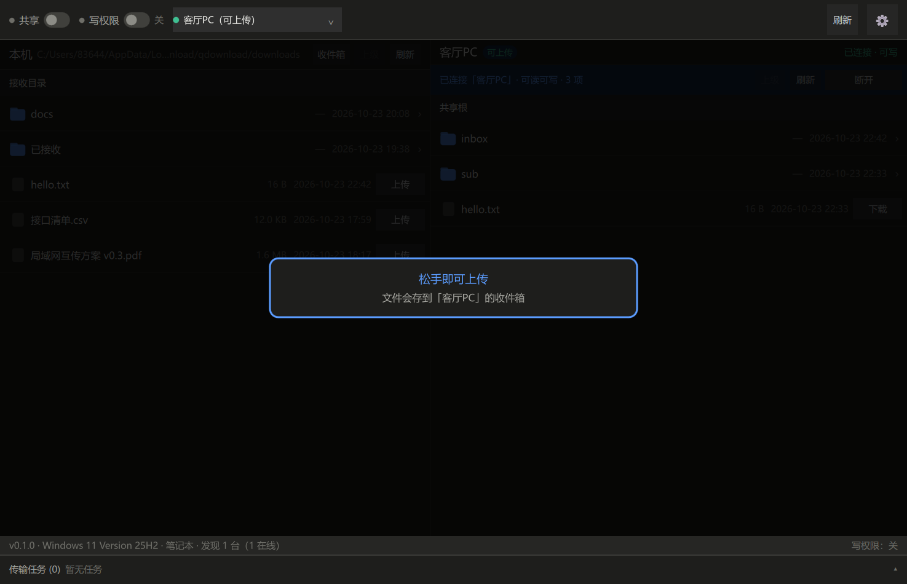
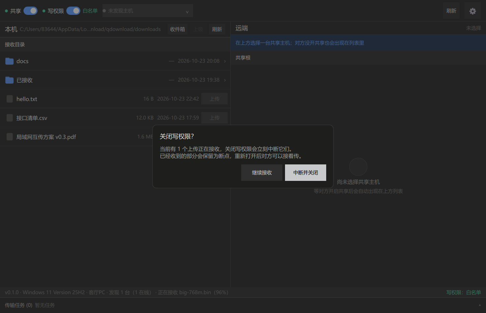
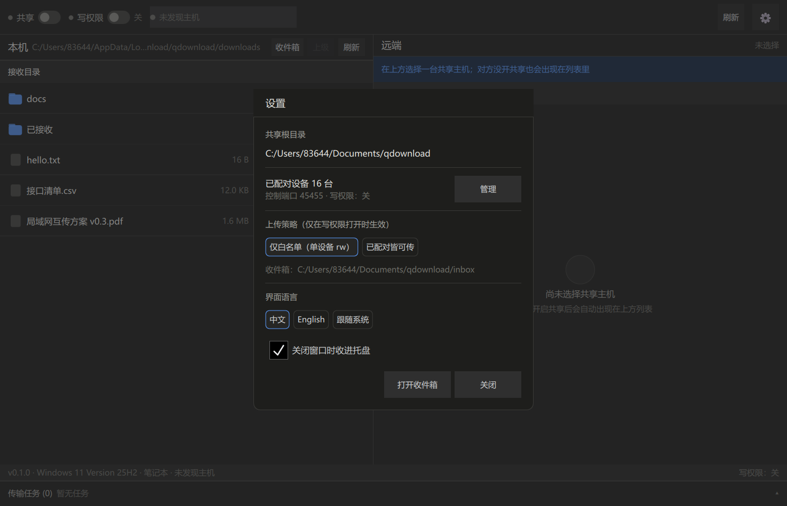
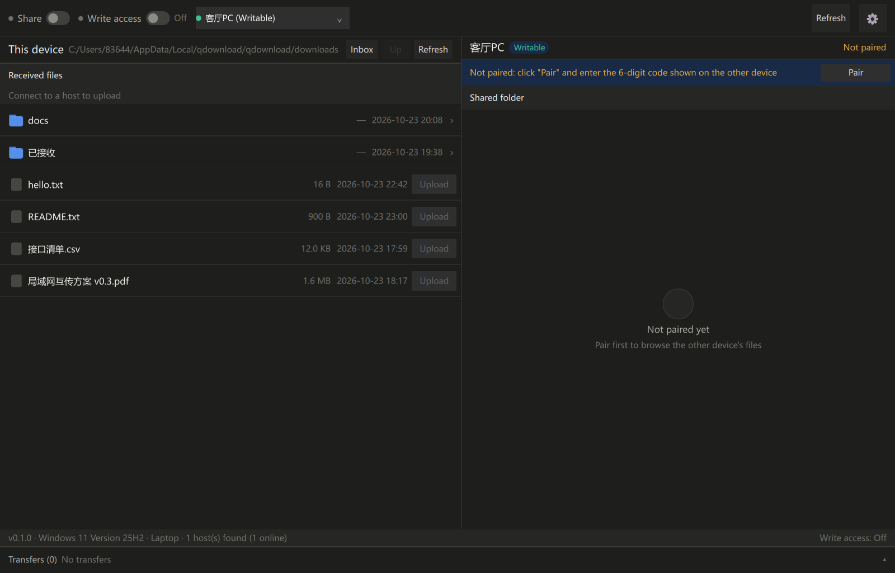
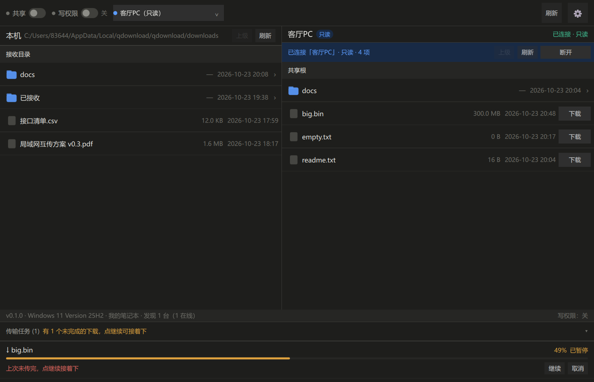
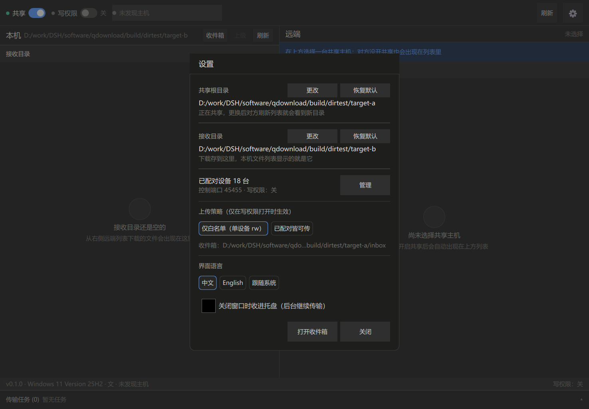
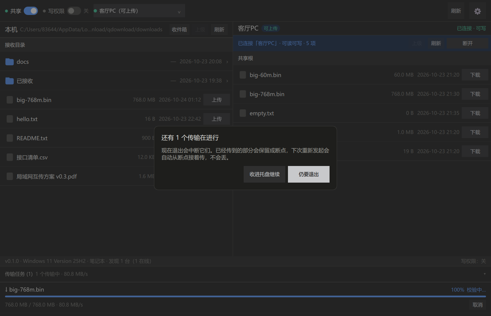

# qdownload

跨平台（Windows / Linux / Android）局域网文件互传工具。Qt 6 + QML + C++17。

同一份程序在每台设备上既是**共享端**（监听、等别人来取）也是**客户端**（发现别人、去取文件）。
设计文档见 [`docs/01-设计流程与架构设计.md`](docs/01-设计流程与架构设计.md)。

## 当前进度

**M13 校验前置已完成** — 收尾阶段不再"读完整个文件算 SHA-256"，摘要与传输同时发生：

- 发送端（下载时是主机、上传时是客户端）在**传输开始那一刻**就把整文件摘要排进后台算，
  算好随段表下发/推送；接收端收完只剩一次内存比对，GB 级文件的"100% 卡住"消失。
- 接收端的本地摘要同样是"顺手"算的：多段在合并分片那一遍算，单段从 0 开始时边收边算。
- 比对不一致：删掉收到的副本、任务判失败并留痕；上传侧由主机判、客户端不重试、**不删源文件**。
- 老版本互通：拿不到推送时自动回退到原来的 `CHECKSUM_REQ` 拉取，仍拿不到才降级成"只校验大小"。

细节见下方 [校验前置要点（M13）](#校验前置要点m13)。

三平台出包入口：`tools/package_windows.sh`、`tools/package_linux.sh`、
`tools/package_android.sh`。

| 里程碑 | 状态 |
|---|---|
| M1 骨架（CMake + QML 壳 + Theme + 日志） | ✅ |
| M2 组播发现 + 主机列表 | ✅ |
| M3 配对码与鉴权 | ✅ |
| M4 目录列表（分页 + 面包屑） | ✅ |
| M5 下载 + 进度 | ✅ |
| M6 断点续传（跨进程 + fileKey + 全量校验） | ✅ |
| M7 上传 + 写权限开关 | ✅ |
| M8 打磨（多网卡 / 托盘 / 拖拽 / 通知 / i18n）与 Windows 打包 | ✅ |
| M9 Android 真机验证（存储/前台服务/组播）与并发控制 | ✅ 已验证通过 |
| M10 传输限速 | ✅（令牌桶 + 接收端背压，上下行共用） |
| M11 出包脚本化（Linux 便携包 + deb、Android APK/AAB + 签名） | ✅ |
| M12 单文件多连接（段表 + 按需领票，连接数可动态调整） | ✅ |
| M13 校验前置（摘要随表下发 + 边收边算，收尾只剩比对） | ✅ |
| M14 文件删除（本机直删 + 远端删共享文件，需写权限，界面二次确认） | ✅ |

拖文件进窗口就上传（草稿文件本身不进传输队列，松手才发）：



关写权限前的二次确认，底部状态栏同时显示「正在接收 big-768m.bin」：



设置面板（上传策略、收件箱、界面语言、关闭窗口收进托盘）：



英文界面（`--lang en`，无需重启即可在设置里切回中文）：



## 目录结构

```
qdownload/
├── CMakeLists.txt
├── docs/                    设计文档与截图
├── assets/icons/            qdownload.svg（Linux 桌面图标，install 时装入 hicolor）
├── i18n/                    qdownload_en.ts（lupdate 提取，tools/gen_en_ts.py 补译文）
├── android/                 AndroidManifest.xml、前台服务 TransferService.java
├── packaging/linux/         qdownload.desktop（Linux 打包脚本用它生成菜单项）
├── qml/
│   ├── Main.qml             响应式根布局（≥900dp 双栏 / 窄屏双 Tab）、拖拽落区、设置面板
│   ├── Theme.qml            单例：颜色、字号、间距、断点
│   ├── pages/               LocalPage、RemotePage
│   ├── components/          Breadcrumb、FileListView、TransferDrawer、
│   │                        ToggleChip、WriteToggle、PeerSelector、EmptyState、
│   │                        Toast、ConfirmDialog、TrayIcon
│   └── assets/icons/        托盘图标（**必须挂在 qml/ 下**，见「托盘查不到怎么办」）
├── src/
│   ├── main.cpp             启动、命令行、QML 加载、首帧前装翻译
│   ├── app/                 AppController（QML 单例 App）、Logger、LaunchOptions
│   │                        Translation（语言热切换）、SystemNotifier（通知）
│   │                        AndroidService（前台服务桥）
│   ├── net/                 DiscoveryService（多网卡逐条组播）、PeerListModel、PeerInfo
│   │                        MessageCodec（QDL1 帧）、CryptoUtil（HMAC/随机）
│   │                        TrustStore（SQLite）、PairingService（配对码）
│   │                        ControlServer + PeerSession（服务端）、ControlClient（客户端）
│   │                        DataServer（数据通道：一次性令牌 + 裸流 + 背压 + 边收边算摘要）
│   │                        ChecksumCache（整文件 SHA-256 后台算 + 按 fileKey 缓存，受理请求即预热）
│   ├── transfer/            TransferTask（一个文件一个任务，聚合多条段连接 + 分片合并校验）
│   │                        TransferSegment（一条连接 = 一段，各自 pump/限速）
│   │                        TransferModel（抽屉的列表模型）、TransferManager（建/收任务）
│   │                        ResumeStore（SQLite 断点库，跨进程续传）、TransferTypes（分段规划）
│   └── fs/                  SafePath（越界校验）、FileScanner（排序/分页/fileKey）
│                            FileEntry、FileListModel（本机与远端共用）
├── tools/                   独立协议探针（Python，不依赖本程序客户端）
│                            gen_en_ts.py（英译文补全）
│                            package_windows.sh / package_linux.sh / package_android.sh
│                            android_keystore.sh（签名钥匙库）、rate-limit-test.sh
│                            common.sh（三个打包脚本共用的探测与日志函数）
├── dist/                    打包产物（已 gitignore）
└── build/                   构建产物（已 gitignore）
```

## 构建

依赖：Qt 6.5+（建议 6.8 LTS 及以上）、CMake 3.21+、Ninja、C++17 编译器。

本机环境（Windows）：

- Qt：`D:/Qt/6.12.0/mingw_64`
- 编译器：`D:/Qt/Tools/mingw1310_64/bin/g++.exe`
- CMake：`D:/Qt/Tools/CMake_64/bin/cmake.exe`
- Ninja：`D:/Qt/Tools/Ninja/ninja.exe`

```bash
export PATH="/d/Qt/6.12.0/mingw_64/bin:/d/Qt/Tools/mingw1310_64/bin:/d/Qt/Tools/CMake_64/bin:/d/Qt/Tools/Ninja:$PATH"

cmake -S . -B build -G Ninja \
  -DCMAKE_PREFIX_PATH="D:/Qt/6.12.0/mingw_64" \
  -DCMAKE_CXX_COMPILER="D:/Qt/Tools/mingw1310_64/bin/g++.exe" \
  -DCMAKE_BUILD_TYPE=Debug

cmake --build build
```

其他平台用 `qt-cmake` 或 Qt Creator 打开 `CMakeLists.txt` 直接构建即可，源码无需改动。

### Linux 构建与打包

```bash
# 只看环境缺什么，不构建（换机器/进 CI 先跑这个）
bash tools/package_linux.sh --check

# 一键：Release 构建 + 便携包 + .deb
bash tools/package_linux.sh

# 常用变体
bash tools/package_linux.sh --debug          # Debug 包
bash tools/package_linux.sh --no-deb         # 只要便携包
bash tools/package_linux.sh --skip-build     # 已构建过，只重新打包
```

产物：

- `dist/qdownload-<版本>-linux-<架构>.tar.gz` — 解压即用，`./AppRun` 或 `./run.sh` 启动
- `dist/qdownload_<版本>_<amd64|arm64>.deb` — `sudo apt install ./xxx.deb`，装完应用菜单里搜 `qdownload`
- 便携包里还带了 `install.sh`（`sudo ./install.sh [/自定义前缀]`）与 `使用说明.txt`

脚本的取舍，踩坑前值得知道：

| 决策 | 原因 |
|---|---|
| **只搬 `libQt6*` / `libicu*`** | libc、libX11、libGL 跟发行版强绑定，一起搬反而更容易起不来 |
| **不用 patchelf** | 改用 `LD_LIBRARY_PATH` + `usr/bin/qt.conf` 相对路径，少一个外部工具依赖 |
| **用 `qmlimportscanner` 挑 QML 模块** | 只搬用到的模块；扫不到就整棵 `qml/` 一起搬并给警告 |
| **先装到 `dist/.staging-*` 再换上** | 打包中途失败时，上一个能用的包还是完整的 |

环境变量：`QT_PREFIX`（Qt 安装前缀，不设自动探测）、`QT_ROOT`、`BUILD_DIR`、`JOBS`。

### Android 构建

**推荐走脚本**，它会自己找齐 JDK / SDK / NDK / Qt 套件，并给出「缺什么」的明确提示：

```bash
bash tools/package_android.sh --check        # 先看环境
bash tools/package_android.sh                # arm64-v8a Release APK
bash tools/package_android.sh -a x86_64      # 换 ABI（同步换 Qt 套件目录）
bash tools/package_android.sh --aab          # 出 .aab（上架用）
bash tools/package_android.sh --install      # 出完包 adb install -r
```

产物：`dist/qdownload-<版本>-android-<abi>.apk`（约 84MB）。默认**未签名**，
配好 keystore 再跑一次就是签名包：

```bash
bash tools/android_keystore.sh                # 生成 keystore + signing.env
source ~/.qdownload/signing.env
bash tools/package_android.sh
```

手工构建（脚本之外想自己来时用）：本机环境 Qt `D:/Qt/6.12.0/android_arm64_v8a`、
NDK `D:/software/Android/Qt/.../SDK/ndk/27.2.12479018`、ABI `arm64-v8a`、
构建目录 `build/Qt_6_12_0_for_Android_arm64_v8a_Release`。

```bash
export JAVA_HOME="C:/Program Files/Android/openjdk/jdk-21.0.8"   # Gradle 9 要 JDK 17+，本机 JDK 11 不行
export PATH="/d/Qt/Tools/CMake_64/bin:/d/Qt/Tools/QtCreator/bin/jom:$JAVA_HOME/bin:$PATH"

# 只编译 .so（快，用来验证 C++ 侧）
cmake --build build/Qt_6_12_0_for_Android_arm64_v8a_Release --target qdownload -j 8

# 打 APK（androiddeployqt + Gradle 9.5.1 + AGP 9.2.1）
cmake --build build/Qt_6_12_0_for_Android_arm64_v8a_Release --target apk
```

产物：

- `.so`：`build/Qt_6_12_0_for_Android_arm64_v8a_Release/libqdownload_arm64-v8a.so`
- APK：`build/Qt_6_12_0_for_Android_arm64_v8a_Release/android-build-qdownload/build/outputs/apk/release/android-build-qdownload-release-unsigned.apk`
  （84MB，release **未签名**；要签名再配 `QT_ANDROID_SIGN_KEY_PATH` / `QT_ANDROID_SIGN_STORE_PATH` 等属性）

踩过的坑（**桌面端编译不会暴露**——`Q_OS_ANDROID` 分支在 Windows 下整段被预处理器跳过，
所以改完 Android 分支必须单独编一遍 Android，否则问题只会在真机打包那天才炸）：

1. `fatal error: 'QNativeInterface' file not found`
   **不存在** `<QNativeInterface>` 这个头文件，`QNativeInterface::QAndroidApplication`
   声明在 `QtCore/qcoreapplication_platform.h`（Qt 6.9 / 6.12 的 Android 套件里都只有这一处）。
   它属于 **QtCore**，跟 `Qt6::Gui` / `Qt6::GuiPrivate` 无关，所以“CMakeLists 里加 `Qt6::Gui`”救不了，
   要改的是 `#include`。写法：

   ```cpp
   #ifdef Q_OS_ANDROID
   # include <QJniObject>
   # include <QtCore/qcoreapplication_platform.h>
   #endif
   ```

2. `no matching constructor for initialization of 'QJniObject'`
   `QJniObject` 的类名参数只吃 `const char *`，写 `QJniObject(QStringLiteral("android/content/Intent"))`
   编译不过，直接传字符串字面量。

3. `QCryptographicHash::addData(const char*, len)` 在 Qt 6.4 起弃用，clang 下会刷警告，
   统一改成 `addData(QByteArrayView(ptr, len))`。

打包阶段的环境要求（跟代码无关，但一样会挡住出包）：

- **`<uses-sdk>` 不许写进 `AndroidManifest.xml`**：AGP 9.0 起 manifest 里指定 `minSdk`/`targetSdk`
  会让 manifest merger 直接失败（`The <uses-sdk> tag was detected ... no longer allowed for
  controlling SDK versions`）。版本改由 CMake 的 `QT_ANDROID_MIN_SDK_VERSION` /
  `QT_ANDROID_TARGET_SDK_VERSION` 下发到生成的 `gradle.properties`。
- `minSdkVersion` 必须 **>= 28**：Qt 6.12 的 deploy 会校验并报 `Invalid minSdkVersion ... must be >= 28`；
  `targetSdk` 不要写成没装过的平台（会触发联网下载），跟编译 SDK `android-36-ext19` 对齐取 36。
- Gradle 需要 **JDK 17+**：Qt 6.12 模板固定 `gradle-9.5.1`（见
  `D:/Qt/6.12.0/android_arm64_v8a/src/3rdparty/gradle/gradle/wrapper/gradle-wrapper.properties`），
  Gradle 9 起不再支持在 JDK 11 上跑，本机只装了 JDK 11 时会报
  `Gradle requires JVM 17 or later ... currently configured to use JVM 11`；装好 JDK 17 后 `export JAVA_HOME=...` 再 build。
- 打 APK 时会出现 `QML import could not be resolved: QtQuick.Controls.Windows` 之类告警，
  这是 Windows 宿主机上扫描到桌面端默认样式、Android 包里没有该插件导致的，不影响出包；
  Android 上控件会回退到 Basic 风格（外观与桌面端不同，属于已知差异）。

### Android 存储限制（分区存储适配）

Android 10（API 29）起分区存储收紧，能用普通 File API 读写的只有：

- 内部 files 目录：`/data/user/0/<pkg>/files`
- 应用专属外部目录：`/storage/emulated/0/Android/data/<pkg>/files`

公共位置（Download / Documents / sdcard 根）直接 `fopen` 就是 `EACCES`——
这就是「设置里改目录提示没有权限」的来源；而系统的目录选择器返回的是
`content://` 授权 URI，`QFile` 同样打不开。对策（见 `src/app/AndroidStorage.cpp`）：

1. **出厂默认目录改放应用专属目录**（`AndroidStorage::preferredDir()`），
   不再像桌面那样放「文档」下；
2. **安卓改用内置目录浏览器**（`qml/components/DirBrowser.qml`）代替系统对话框：
   只列出「实际试写通过」的位置（应用专属目录 / 内部存储），选到哪一步都能用；
   支持逐级进入、返回上级、新建子文件夹；
3. 想把目录指到任意位置：浏览器里有「去授权」按钮，跳系统设置页开
   **所有文件访问权限**（`MANAGE_EXTERNAL_STORAGE`，Android 9/10 走
   `WRITE_EXTERNAL_STORAGE` 运行时权限）。授权回来存储位置列表会多出
   「共享存储空间」根，从此可以浏览整个 sdcard；
4. **启动自愈**：上次存下的目录这回写不了（重装、权限收紧）就退回出厂默认，
   并在启动时弹一条说明，避免「共享开关拨了没反应」却查不出原因。

排障：`--demo-dir-browser` 可以在**桌面**上强制走这套内置浏览器，
把整条交互链（浏览/进入/新建/选择）在真机之前先过一遍。

## 运行

```bash
./build/qdownload.exe
```

开发辅助参数：

| 参数 | 作用 |
|---|---|
| `--self-test` | 加载 QML 后立即退出，用于 CI / 构建自检（配合 `QT_QPA_PLATFORM=offscreen`） |
| `--screenshot <file>` | 渲染一帧存成 PNG 后退出，用于生成文档截图 |
| `--size <WxH>` | 配合 `--screenshot` 指定窗口尺寸，验证响应式布局 |
| `--instance <tag>` | 实例名。同时覆盖 peerId（`dev-<tag>`）、显示名与日志文件名。**同机多开不再需要它**（程序会自动编号，见下方「同机多开」） |
| `--name <text>` | 覆盖主机显示名 |
| `--peer-id <id>` | 覆盖 peerId，不落盘 |
| `--probe <seconds>` | 无界面跑 N 秒，按 `PEER id\|name\|ip\|状态\|online\|副标题` 打印发现结果后退出 |
| `--share` / `--write` | 本次运行强制开启共享 / 写权限（不写入设置） |
| `--screenshot-delay <ms>` | 截图前等待，便于等对端连上、等弹窗出现 |
| `--pair-code <code>` | 固定配对码（免读屏，联调用） |
| `--auto-approve` / `--auto-approve-write` | 收到配对请求自动放行，并可选授予 rw |
| `--pair-test <peerId> <code>` | 无界面配对测试：发现→连接→配对，打印 `PAIR_TEST_OK/FAL` 后退出 |
| `--watch <ms>` | 配合 `--pair-test`：Ready 后继续观察，打印 `PAIR_TEST_CAN_UPLOAD` 变化与 `PAIR_TEST_CONN` 状态流水（掉线重连、手动断开是否被自动拉回都看它） |
| `--disconnect-after <ms>` | 配合 `--watch`：Ready 后 N 毫秒调一次 `disconnectPeer()`（与界面「断开」同入口），验证手动断开后不再自动重连 |
| `--set-name <name>` | 无界面设置本端名称并退出（空串=恢复默认主机名）；与设置面板「保存」走同一个 setter，落库并立刻广播 |
| `--toggle-write-after <ms>` | N 毫秒后翻转写权限开关，验证 PERM_UPDATE 即时生效 |
| `--toggle-share-after <ms>` | N 毫秒后翻转共享开关，验证列目录立即 403 |
| `--share-root <path>` | 本次运行覆盖共享根（不写入设置） |
| `--receive-root <path>` | 本次运行覆盖接收目录（不写入设置） |
| `--list <path>` | 配合 `--pair-test`：连上后读取该虚拟路径并打印条目，自动翻页 |
| `--demo-remote` / `--demo-path <p>` | 截图用：启动即切到远端页 / 直接进入某路径 |
| `--get <path>` | 配合 `--pair-test`：连上后下载该虚拟路径（**可重复**，多个一起发；超出「传输并发数」的自动排队），打印 `GET_TEST_PROGRESS/RESULT` |
| `--rm <path>` | 配合 `--pair-test`：删掉主机上该虚拟路径的文件，再列一次目录复核，打印 `RM_TEST_PRESENT_BEFORE` / `RM_TEST_RESULT present_after=` |
| `--rm-local <path>` | 删掉本机接收目录里的某个文件（虚拟路径）后退出，打印 `RM_LOCAL_TEST path=… ok=1` |
| `--pause-at <pct>` / `--cancel-at <pct>` | 配合 `--get`：下到该百分比时暂停（1.2s 后自动继续）/ 取消 |
| `--demo-transfers` / `--demo-get <p>` | 截图用：启动即展开传输抽屉 / 连上后自动下载某文件 |
| `--kill-at <pct>` | 配合 `--get`：下到该百分比时 `_Exit` 硬退出（模拟下到一半被杀进程） |
| `--resume` | 配合 `--pair-test`：把启动时恢复出来的断点任务全部继续，打印 `RESUME_TEST_*` |
| `--put <path>` | 配合 `--pair-test`：连上后上传该本地文件（可重复），打印 `PUT_TEST_PROGRESS/RESULT` |
| `--put-pause-at <pct>` / `--put-cancel-at <pct>` | 配合 `--put`：传到该百分比时暂停（1.2s 后自动继续）/ 取消 |
| `--demo-put <path>` | 截图用：连上后自动上传某本地文件，让抽屉里有真实的上传进度 |
| `--lang <zh_CN\|en\|system>` | 启动即用该语言（不写入设置），用于验证译文完整性 |
| `--demo-lang-switch <ms>` | 截图用：N 毫秒后切到另一种语言，验证 `retranslate()` 热切换 |
| `--demo-drop <0-100>` | 截图用：强制显示拖拽遮罩（真机拖拽没法脚本化） |
| `--demo-confirm-write-at <ms>` | 截图用：N 毫秒后弹出「关写权限」二次确认框 |
| `--demo-settings` | 截图用：启动即打开设置面板 |
| `--demo-dir-browser` | 排障/截图：桌面也强制走安卓那套内置目录浏览器 |
| `--tray-on-close` | 本次运行强制「关窗收进托盘」（不写入设置），验证托盘/退出两条分支 |
| `--demo-quit-at <ms>` | N 毫秒后自己触发一次「关闭窗口」，验证退出确认流程 |
| `--demo-dir <path>` / `--demo-dir-role <0\|1>` | 启动 1.5s 后自动切换共享根/接收目录，把体检结果打进日志（验证换目录的接受/拒绝分支） |
| `--limit <mbps>` | 本次运行的传输限速（MB/s，0 = 不限速，不写入设置），配合 `--get`/`--put` 验证限速 |
| `--segments <count>` | 本次运行的**单文件连接数**（1–8，不写入设置）。同机双实例验证多段下载/上传/续传 |
| `--workers-at <pct:count>` | 配合 `--get`/`--put`：传到该百分比时把单文件连接数改成 count，验证传输中动态增减 |
| `--ctrl-port <port>` | 覆盖控制通道监听端口（默认 45455）。同机多开时用不着手动错开：端口被占会自动往后找（实际端口随心跳广播，对端照它连） |

### 验证配对（同一台机器即可）

```bash
# 主机：固定码 888888，自动放行并授予 rw
./build/qdownload.exe --instance a --name 客厅PC --share --write \
  --pair-code 888888 --auto-approve --auto-approve-write --probe 30

# 客户端：连接 → 配对 → 打印结果
./build/qdownload.exe --instance b --name 笔记本 --pair-test dev-a 888888
# 期望：PAIR_TEST_OK peer=dev-a perm=rw canUpload=1
```

第二次再跑客户端（配对码随便填）会走令牌鉴权直接 Ready——令牌存在 `trust.db` 里。

### 验证权限即时生效

```bash
# 主机：6 秒后把写权限翻成关
./build/qdownload.exe --instance a --name 客厅PC --share --write --pair-code 888888 \
  --auto-approve --auto-approve-write --toggle-write-after 6000 --probe 20

# 客户端：Ready 后观察 12 秒
./build/qdownload.exe --instance b --name 笔记本 --pair-test dev-a 888888 --watch 12000
# 期望：PAIR_TEST_OK ... canUpload=1  →  PAIR_TEST_CAN_UPLOAD 0
```

### 验证目录列表

```bash
export MSYS_NO_PATHCONV=1   # 否则 Git Bash 会把 "--list /" 的 "/" 换成 C:/Program Files/Git/

# 主机：指向一份准备好的目录树
./build/qdownload.exe --instance a --name 客厅PC --share --write \
  --share-root "D:/demo-share" --pair-code 888888 \
  --auto-approve --auto-approve-write --probe 60

# 客户端：配对后列共享根（自动翻页，最多 3 页）
./build/qdownload.exe --instance b --name 笔记本 --pair-test dev-a 888888 --list /
# 期望：LIST_TEST path=/ total=6 rows=6 pages=1 error=
#       LIST_ENTRY dir|安装包|0|2026-10-23 19:36
```

### 验证下载（含续传与取消）

```bash
export MSYS_NO_PATHCONV=1

# 主机：共享一个含大文件的目录
./build/qdownload.exe --instance a --name 客厅PC --share --pair-code 888888 \
  --auto-approve --auto-approve-write --share-root "D:/demo-share" --probe 300

# 客户端：下载 1.2GB 文件，下到 30% 暂停、1.2 秒后继续
./build/qdownload.exe --instance b --name 笔记本 --pair-test dev-a 888888 \
  --get /big.bin --pause-at 30

# 期望：
#   GET_TEST_PROGRESS 30% 86.2 MB/s transferring
#   GET_TEST_PAUSED 31%
#   GET_TEST_RESUMED
#   申请下载 /big.bin（offset=399670040，续传任务 t-1）
#   GET_TEST_RESULT state=completed size=1.17 GB / 1.17 GB ...
```

取消（`--cancel-at 15`）会打印 `state=canceled`，且接收目录里不留目标文件与 `.qdpart`。

协议护栏可由独立探针验证（Python，不依赖本程序的客户端代码，等于换个实现跑一遍协议）：

```bash
python tools/probe_auth.py 45455             # 未鉴权列目录 → 401
python tools/probe_list.py 45455 888888 12   # 配对 → 列目录 → 12 秒后（主机已关共享）→ 403
python tools/probe_upload.py 45455           # 未鉴权上传 → 401；以 ro 身份配对后上传 → 403
```

### 验证上传（含断点、打断与取消）

```bash
export MSYS_NO_PATHCONV=1

# 主机：共享 + 开写权限，启动 6 秒后把写权限拨成关（模拟用户中途不想收了）
./build/qdownload.exe --instance host --name 客厅PC --share --write \
  --pair-code 123456 --auto-approve --auto-approve-write \
  --share-root "D:/work/DSH/software/qdownload/build/m7-host" \
  --toggle-write-after 6000 --probe 120

# 客户端：上传 768MB
./build/qdownload.exe --instance cli --name 笔记本 \
  --pair-test dev-host 123456 \
  --put "D:/work/DSH/software/qdownload/build/m7-src/big-768m.bin"

# 期望：
#   PUT_TEST_PROGRESS t-1 62% 120.3 MB/s transferring
#   主机日志：已中断 1 个上传：主机已关闭接收文件（断点已保留）
#   PUT_TEST_RESULT id=t-1 state=paused ... error=主机已关闭接收文件
#   收件箱留 525,860,864 字节 big-768m.bin.qdpart（+ .qdpart.key）
```

再跑一次同样的 `--put`（主机这次开着写权限）就会从断点续上去：

```bash
# 期望：主机日志「接收上传 big-768m.bin（805306368 字节，从 525860864 起）」
#       PUT_TEST_RESULT id=t-1 state=completed，sha256 与源文件一致
```

`--put` 可以给多个文件：一条任务一行 `PUT_TEST_RESULT`，**全部到终态才退出**，
退出码 0 只在全成功时给（暂停/失败给 7）。上传点「继续」会把原任务置 canceled 再新建一条，
所以 `--put-pause-at` 场景下会出现一行 `canceled` 加一行 `completed`，那是续传的正常形态。

`--toggle-write-after` 挑在**校验期**（如 12000 ms）则会看到另一种结果：主机记一条
「上传已收满、正在校验，忽略本次中断」，客户端照常 `completed`——字节都收完了，
这时候按"中断"处理只会造出一个假的暂停。

取消（`--put-cancel-at 20`）会打印 `state=canceled`，收件箱里不留 `.qdpart` 与 `.qdpart.key`。

### 同机多开（不需要第二台设备，也不需要任何参数）

```bash
# 终端 1：甲机，共享 + 可上传
./build/qdownload.exe --name 甲机 --share --write

# 终端 2：乙机，观察 8 秒后打印发现结果
./build/qdownload.exe --probe 8
```

**同一个目录开两份**：第二个进程自动认领「本机第 2 个实例」（`data/instance-2/`）——
它用自己的 `settings.ini`（因此有自己的 `peerId`）、默认名自动带编号（`甲机` / `甲机 (2)`）；
控制端口被占会自动往后找（45455→45456…），实际端口随心跳广播，不影响连接。

**两个不同目录各开一份**（拷贝了整个程序目录、或从别处搬了一个 `data/` 过来）时，
两份配置里可能带着**同一个 peerId**。程序启动时会在**本机范围**（`%LOCALAPPDATA%/qdownload/instances`
下的 `peer-<id>.lock`）认领一次，发现被另一个活进程占着就自动换一个新的 UUID 并落盘，
同时把默认名改成 `主机名 (2)`：

```
peerId 4c719460-… 已被本机另一个进程占用（多半是复制过程序目录或 data/），改用 2dee7609-…
```

被占的是「后启动的那个」，换过一次就不再变（它此后一直用新 id）。命令行显式指定的
`--instance <tag>` 不会被自动改写，只会在撞车时打一行警告。

退出时锁文件会自动释放；进程被硬杀后 5 秒内也能按 PID 判死回收，下次启动仍旧是主实例。
想固定某个身份做联调，仍然可以用 `--instance <tag>` 覆盖 peerId。

日志位置：

- Windows：`%LOCALAPPDATA%/qdownload/qdownload/logs/qdownload-YYYY-MM-DD[-tag].log`
- Linux：`~/.local/share/qdownload/qdownload/logs/`
- 单文件超过 5 MB 自动滚动到 `.1`

## 界面说明

- 顶栏常驻两个总开关：**共享**（是否对外提供文件）与**写权限**（是否接收上传），两处独立。
- 主机下拉框显示发现到的设备：`客厅PC（可上传 / 只读 / 未共享 / 离线）`，圆点颜色对应状态。
  对方关掉共享也会出现在列表里，只是标记为「未共享」——否则会让人以为网络故障。
- 桌面 ≥900dp：左右双栏（本机 / 远端）；窄屏：本机 / 远端两个 Tab + 底部传输抽屉。
- 本机页头有「收件箱」按钮（上传落点不在接收目录树里，没有快捷入口很难找到）；
  本机列表每行有「上传」，对方没给写权限时置灰。
- 有文件正在传进来时，底部状态栏会显示「正在接收 2 个文件到 客厅PC 的收件箱」这类摘要。
- 底部状态栏显示版本、平台、设备名、发现数量与当前写权限范围。
- 组播不可用（端口占用 / 无可用网卡）时，顶栏下方会出现一条黄色提示条并给出具体原因。
- **拖拽上传**：把文件拖进窗口（任意位置）会出现浮层，标明「松手后上传到 客厅PC 的收件箱」；
  写权限关着 / 没共享 / 未配对会在浮层里当场上色说明原因，松手不做无用功。
- **关闭窗口**：默认直接退出。有传输在进行时会先问「还有 N 个传输在进行」——
  「仍要退出」或「收进托盘继续」；设了「关闭窗口时收进托盘（后台继续传输）」才会在无传输时静默收进托盘。
- **系统通知**：下载完成、上传完成、有人要上传、写权限被关导致上传中断，各发一条；
  窗口在前台时不弹（避免自己看自己）。Android 侧同一份接口走通知栏 + 前台服务。
- **界面语言**：设置里可选中/英/跟随系统，切换即时生效不重启（`QQmlEngine::retranslate()`
  加手动重建面包屑根节点——`tr()` 算好的字符串不在绑定里，热切换管不到）。
- **传输并发数**：设置里可调（1–16，默认 3，存 `transfer/threads`）。一个任务就是一条
  数据连接，超出的下载/上传**自动排队**，前面的传完（或被取消/暂停）立刻接上；
  调小不打断正在传的任务，调大立即放行排队中的。之前上传侧写死「最多 3 个、超了直接拒绝」，
  现在两端统一走排队。
- **传输限速（M10）**：设置里可设（0–1000 MB/s，0 = 不限速，存 `transfer/speedLimitMbps`）。
  进程级**令牌桶**（`RateLimiter`），上下行共用一个上限、所有任务共享配额——
  一个文件在传就它吃满，多个同时传就大家分，所以调大并发数不会把限速穿透。
  - **发送侧精确限**：`TransferTask::pumpUpload` 按令牌发块，令牌不够就定时器稍后再来；
    限速时同时压低发送水位，避免开局把 2MB 一次性推出去。
  - **接收侧靠 TCP 背压**：下载端把 socket 读缓冲压到突发容量附近（`setReadBufferSize`），
    不读的字节留在内核，接收窗口随之收缩，对端自然写不动——不用改协议、对端无需配合。
    代价是收尾处要 `drainSocket()`：对端发完就关连接，此时缓冲里可能还压着最后一个
    没来得及读的窗口，必须先落盘再判成败，否则限速下载永远"卡在 98% 转已暂停"（实测踩到）。
  - 突发容量 = 速率的一半（256KB–4MB 之间），既保证速率精度又限制突发。
  - 改限速立即生效：setter 会刷新所有活跃任务的接收窗口并各 pump 一次。
  - 实测：24MB 下载，不限速 2 秒、限速 2MB/s 14 秒（含握手），SHA-256 与不限速完全一致；
    上传 12MB 同理（2 秒 vs 8 秒）。
- **单文件连接数（M12）**：设置里可调（1–8，默认 3，存 `transfer/segments`，
  命令行 `--segments` 可临时覆盖）。含义是**一个文件同时开几条数据连接**，
  谁先传完谁去领下一段。**改动立即生效**：正在跑的任务会立刻补开或停掉多余连接。
  - **段表 + worker 池**：服务端按 `chunkSize = clamp(总大小 / (连接数 × 4), 4MB, 32MB)`
    把文件切成一份段表（最多 128 段），随 `DOWNLOAD_ACCEPT`/`UPLOAD_ACCEPT` 下发，
    每段的 `offset/length/done` 都在表里。客户端每条连接空下来就发 `SEG_REQ` 领一段，
    传完立刻领下一段——没有"连接 i 只传第 i 段"的静态绑定，所以不存在拖尾的那条慢连接。
  - **区间只由服务端算一次**：客户端只报"我想要几条连接"，段表和区间全部由主机裁决。
    两端各算一遍，取整差一个字节就是坏文件，而且只在最后校验才暴露。
  - **票是按需发的**：`DataGrant` 仍然 5 分钟过期、用掉即删，所以不能预先批量发。
    `SEG_REQ`/`SEG_RESP`（24/25）就是"空闲连接来领票"；首段的票随 ACCEPT 直接带上，
    省一次往返。数据通道协议本身没变（裸流 + `QDAT` 握手）。
  - **失败重领**：某段连接断了只是这一段没传完，不会作废整份传输。客户端把它退回队列、
    换条连接重试（上限 3 次），服务端按盘上分片大小接着收。
  - **落盘**：下载侧写 `.qdpart.seg<i>` 分片加一份 `.qdpart.qseg` 元信息（总大小、段数、段长），
    全部收满后按序合并成 `.qdpart` → 校验大小 → 改名落地 → 删分片。分片大小天然就是权威进度，
    跨进程续传不需要位图。上传侧主机同样按段写 `<partPath>.seg<i>`，用 `UploadGroup`
    按段号记账聚合，合并、校验、改名、算 SHA-256，最后只发一次完成事件。
  - **断点续传**：段长或总大小变了（对端文件被换过）就清掉旧分片重来；续传时段长沿用
    `.qseg` 里记的，保证盘上分片和段表对得上号。`ResumeStore` 认 `.seg<i>` 形态，
    不然多段断点会被当死引用清掉。
  - 限速共存：每条连接独立领令牌，连接变多只是并发度变高，总速率仍被同一个令牌桶压住。
  - 实测：24MB 下载 1 条连接 2 秒、4 条连接 1 秒，SHA-256 均与源一致；12MB 上传 4 条连接
    7 秒（2MB/s 限速）；4 条连接 + 限速 + 中途暂停/继续、4 条连接 + 杀进程后续传、
    传输中把连接数从 1 改成 6，全部校验通过。本机环回带宽充裕时多连接没有明显收益，
    收益出现在高延迟链路上。
- **本端名称**：设置里可改（见 M8 收尾），保存后立即重新广播。

## 校验前置要点（M13）

老流程的收尾是"三遍全量 I/O + 一次往返"：合并分片 → 读完整个文件算 SHA-256 → 再 `CHECKSUM_REQ`
问主机 → 主机也读完整个文件算一遍。GB 级文件光这一截就是好几秒，用户看到的是"100% 卡住不动"。

现在摘要与传输**同时**发生，收尾只剩一次内存里的比对：

- **生成时机**：
  - 下载：主机在 `DOWNLOAD_REQ` 受理的那一刻就把整文件 SHA-256 排进后台线程池（`ChecksumCache`，
    按 `fileKey` 缓存；同一文件传第二遍是命中）。**不再等客户端收完回来问。**
  - 上传：客户端开工即后台算源文件摘要，与发送并行，最后一个字节发出去时它早已算好。
  - 收端本地摘要：多段在**合并分片那一遍**顺手算（合并本来就要顺序读一遍）；
    单段且从 0 开始则**边收边算**（连接收到的字节顺序就是文件顺序）；只有"单段 + 续传"
    这种前半段不在本次连接里的情形，才回退成收完读一遍。
- **随表传递**：`DOWNLOAD_ACCEPT` 带 `sha256`（命中缓存时当场给），算得慢就用新增的
  `CHECKSUM_PUSH`（26）在传输途中推过去；`SEG_RESP` 也会捎带。上传方向反过来：客户端把摘要
  搭在 `SEG_REQ`（领段票）上捎过去，或单独 `CHECKSUM_PUSH`。**都不占额外往返。**
- **接收端比对**：收完（改名前后的落地步骤不变）拿本地摘要与随表传来的值逐字比对，
  一致才置 Completed。收尾时若摘要还差几毫秒没到，先等 500ms 宽限再补拉一次
  `CHECKSUM_REQ`——那 500ms 就是"推送只比最后一个字节晚一点点"的常见情形，抢着发请求等于白跑一趟。
- **不一致怎么办**：**收到的副本删掉、任务判失败**，并在通知里写明"内容与主机不一致，已删除"。
  留着大小对、内容错的文件比失败更糟——用户会当它是好文件继续用。上传方向由**主机**做这个判断：
  它合并时算出的摘要对不上就把副本删掉，回 `UPLOAD_DONE{ok:false, checksumMismatch:true}`，
  客户端直接判失败而**不做可续传重试**（重试同样的内容只会再错一次），并且**绝不删用户源文件**。
- **兼容与降级**：老主机不认 `sha256`/`CHECKSUM_PUSH` 时，新客户端走原来的 `CHECKSUM_REQ` 拉取通道
  （主机侧这道口子保留）；两边都拿不到摘要才降级成"只校验了大小"，且必须在界面上留痕，
  绝不静默通过。`CHECKSUM_PUSH` 是新消息号，老客户端收到会忽略。

## 删除文件要点（M14）

列表里每个文件行多了一个红色的「删除」，本机页和远端页都有；目录不给删（进去逐个删，避免一次
递归删掉整棵树）。

- **本机页**：直接 `QFile::remove` 接收目录里的那个文件。正在接收的任务指向同一个文件时拒绝，
  否则任务收尾会对着一个不存在的文件改名校验。
- **远端页**：发 `DELETE_REQ{path}` 让**主机**去删。主机侧按写权限判定（总开关 + 白名单/rw，
  与上传同一套 `canUploadFor`），路径再过一遍 `SafePath::resolve` 沙箱，只删普通文件，
  共享根本身删不了。结果回 `DELETE_RESP{ok, message}`，客户端据此刷新列表并提示。
- **权限**：对方没开写权限 / 自己是只读设备时，按钮置灰且不发请求（服务端仍会再判一次，
  这层只是让提示更具体）。
- **确认**：两个页面都弹二次确认框，写明"永久删除，不进回收站"；远端还会带上对方设备名。

CLI 复核：`--rm /inbox/x.bin`（主机侧删除 + 列表复核）、`--rm-local /x.bin`（本机删除）。

## 组播发现要点（M2）

- 组 `239.255.42.99:45454`，TTL=1，只在内网扩散；socket 用 `ShareAddress|ReuseAddressHint`，允许同机多实例。
- 心跳字段：`{app, proto, t:"ANNOUNCE", peerId, name, platform, ctrlPort, sharing, write, policy, version, ts}`，
  **不含任何目录或文件名**。
- 判在线用本机接收时间，不采信报文里的 `ts`（跨设备时钟不同步）。
- 关闭共享仍继续广播，只是 `sharing=false`，让对端显示「未共享」而不是「消失」。
- 提速：启动后 300ms/900ms 各补发一次心跳；发现陌生主机立即回一发（限流 1 秒），
  首次互相发现从最坏 3 秒压到 1 秒内。
- 多网卡（VPN / Hyper-V 虚拟交换机）：M8 已改为**逐网卡各发一份**——每张有 IPv4 的网卡绑一个
  只发不收的 `QUdpSocket`（`bind(本机IPv4, 0)`，绑定地址就决定了出接口），心跳从每张网卡都出去一份。
  不用 `IP_MULTICAST_IF` 原生 socket：Qt 的 `QNetworkDatagram::setInterfaceIndex` 在 Windows 上
  返回成功但包发不出去（实测监听端零收到），换绑地址这条路才是可用的。网卡指纹每 15 秒复查一次，
  插拔网线 / 连上 VPN 后自动补 join，消失的网卡 `leaveMulticastGroup`。
- 多网卡会让**同一台设备被重复上报**（一张网卡一份心跳），也可能在回环地址与真实地址之间跳。
  现在 800ms 内状态无变化只刷新 `lastSeen` 不发信号，且回环地址优先级最低、不覆盖 `192.168.x.x`。
- Android 侧已接 `WifiManager.MulticastLock`（不持有就收不到组播），真机实测可正常发现对端。

## 配对与鉴权要点（M3）

- **配对码由共享端生成并显示**，客户端只负责输入；网上传的是 `HMAC(code, nonce + peerId)`，码本身不出网。
- **双条件放行**：码算对了（verified）还要主机主人点「允许」（approved），两者都成立才下发令牌。
  主机点允许时可勾选「允许上传」，决定给 `ro` 还是 `rw`。
- 令牌 32 字节，存 `trust.db`；之后每次连接走 `HELLO → AUTH_REQ{HMAC(token, nonce)}`，用户无感。
- 错码提示剩余次数，连错 5 次锁 60 秒；配对码 120 秒过期。
- 主机撤销授权 → 客户端下次鉴权收到 401 → 自动删除本地令牌并回到「未配对」。
- 写权限/策略/单设备权限变更 → 已连接设备 1 秒内收到 `PERM_UPDATE`，界面上传按钮即时联动。
- 控制端口被占用会 +1 重试，实际端口写回组播心跳，客户端才连得对。
- **禁用系统代理**：局域网 P2P 不能走 `http_proxy`（企业代理/VPN 常见），否则报
  *The proxy type is invalid for this operation*；已在全局与 socket 上双重设为 `NoProxy`。

## 目录列表要点（M4）

- 协议里只有**虚拟路径**（`/` 开头，相对共享根），客户端无法表达绝对路径——这是防穿越的第一道闸。
- `SafePath::resolve` 三层校验：语法层拒 `..`/反斜杠/盘符/控制字符 → `canonicalFilePath()` 解符号链接
  → 结果必须落在共享根内。指向根外的软链在这一步被拦下。
- 排序在服务端做（目录优先、中文按拼音），客户端**不二次排序**：分页场景下重排会让第二页插到第一页前面。
- 分页 200 条/页，滚到底自动要下一页；`offset != 当前行数` 的响应直接丢弃（宁可少一页也不留空洞）。
- 列表**不计算 fileKey**（每项要读首尾各 1MB，200 项会卡十几秒），留到发起传输时按需算一次。
- 主机关共享**不断已有连接**：推 `PERM_UPDATE{sharing:false}` 让对端立刻看到，`LIST_REQ` 回 403；
  拨回来对方不用重连。
- 本机页浏览的是**接收目录**（`%LOCALAPPDATA%/qdownload/qdownload/downloads`），与共享根分开。

## 下载要点（M5）

- **两段式**：控制通道 `DOWNLOAD_REQ{path, offset}` 只负责"批不批"，回 `DOWNLOAD_ACCEPT`
  带一次性令牌 + 数据端口；真正的字节走另一条 TCP，先发 `"QDAT" + token(64B)` 再进入裸流。
- **令牌即权限**：一次性、5 分钟过期、绑 transferId，取走即删。数据端口被同网段扫到，
  没有令牌也取不走一个字节——路径与读权限的判定全在控制通道那一侧完成。
- **背压**：服务端待发数据超过 2MB 就停读文件，等 `bytesWritten` 再续。否则 `write()`
  会把几百 MB 全塞进用户态缓冲，内存飙高且取消要等缓冲排空。
- **落盘**：先写 `<目标>.qdpart`，收满并核对大小后才改名；取消连 `.qdpart` 一起删。
- **进度**：`TransferTask` 每 300ms 推一次（速度做 0.6/0.4 指数平滑），QML 不做任何计时，
  否则界面和实际收字节会各算一套。6 秒没有新字节判中断。
- **暂停/继续**：暂停只关数据连接、保留 `.qdpart`；继续时用已收字节当 `offset` 重新申请，
  服务端 `seek` 后接着发。
- **断点即身份**：`ResumeStore` 主键是 (peerId, 远端路径)，`fileKey` 一起存。恢复时用
  `.qdpart` 的**实际大小**当起点（检查点每 4MB 一次，库里的 `done` 必然落后几 MB）。
- **续传要验身份**：`DOWNLOAD_REQ` 带上上次的 `fileKey`，主机重算后不一致回 `409`，
  客户端作废断点、删 `.qdpart` 并自动从头再下一次——绝不把两份不同文件拼在一起。
- **0 字节没有数据通道**：段表为空、票也不发（`DOWNLOAD_ACCEPT` 里 token 为空）。客户端不会
  因此判"应答不完整"，而是自己建一个空文件、算空内容的摘要（`e3b0c442…`）再比对。
  少了这条，0 字节文件会在 `主机返回的下载信息不完整` 上直接失败。
- **落地要验内容**：摘要不再等收完才算（见 M13）——多段下载在**合并分片那一遍**顺手算出，
  单段从 0 开始下载则**边收边算**；主机那份摘要在受理请求时就已经开算，随表下发。
  不一致删文件判失败；实在拿不到摘要才降级成"只校验大小"并留痕。
- **落点**：保留远端目录结构（`/docs/a.pdf` → 接收目录 `docs/a.pdf`），同名自动加 `(1)`。

## 断点续传实测（M6）

```bash
export MSYS_NO_PATHCONV=1

# 1) 下到 48% 直接被硬杀（不跑析构、不落最后一次检查点）
./build/qdownload.exe --instance cli --pair-test dev-host 888888 \
  --get /big.bin --kill-at 48
#    → GET_TEST_KILL 48%，接收目录留下 big.bin.qdpart

# 2) 重新启动：任务从断点库恢复成「已暂停 49%」，再点一次继续
./build/qdownload.exe --instance cli --pair-test dev-host 888888 --resume
#    → 恢复断点：big.bin（已收 153484212 字节）
#    → RESUME_TEST_RESULT state=completed sha256=d706eaa4…（与源文件一致）
```

`--pause-at 30`（进程内暂停 → 1.2s 后继续）与 `--cancel-at 20`（取消后 `.qdpart`/
目标文件/断点记录三者都不残留）仍在回归里跑。



## 单文件多连接要点（M12）

一句话：**服务端出一份段表，客户端开 N 条连接，谁空下来谁去领下一段。**

- **段表由服务端生成**：`chunkSizeFor(总大小, 连接数) = clamp(总大小 / (连接数 × 4), 4MB, 32MB)`，
  再按 `kMaxChunks = 128` 兜底。每段 4 次发完一轮才轮回到同一段，这个比例是为了让所有连接
  同时有活干又不至于切得太碎。段表随 `DOWNLOAD_ACCEPT`/`UPLOAD_ACCEPT` 下发，
  带 `chunkSize`、`segmentCount` 和每段 `{index, offset, length, done}`。
  **区间只由服务端算一次**——两端各算一遍，取整差一个字节就是坏文件。
- **按需领票**：票（`DataGrant`）是一次性的、5 分钟过期，所以不能预发。
  空闲连接发 `SEG_REQ{transferId, index, done}`，服务端回 `SEG_RESP{token, offset, length,
  done, complete}` 或 `{ok:false, code}`（410 = 表已失效、400 = 段号越界、401/403 = 权限）。
  首段的票随 ACCEPT 直接下发，省一次往返。数据通道协议一个字没改
  （裸流 + `QDAT` 握手），老客户端只看顶层 `token/offset`，`segments` 为空就退化成单段。
- **下载落盘**：`<目标>.qdpart.seg<i>` 分片 + `<目标>.qdpart.qseg` 元信息（总大小、段数、段长）。
  全部收满后按序合并进 `.qdpart` → 核对大小 → 改名落地 → 删分片和元信息。
  **分片大小天然就是权威进度**，不需要位图，也不怕进程被硬杀。
- **上传落盘**：主机侧同样写 `<partPath>.seg<i>`，`DataServer` 的 `UploadGroup`
  **按段号记账**（`finished[]`）而不是简单累加计数——同段被重复上报不会把"到齐"提前。
  聚合进度节流 500ms 上报（不然 8 段各报各的，抽屉会抖）。全部到齐才合并 → 逐段核对长度
  → 校验总大小 → 改名 →（摘要已在合并那一遍算好，与发送端声明值比对）→ 只发**一次** `UploadDone`。
- **单段失败不等于整体失败**：某条连接断了只把这一段退回队列，客户端换条连接重领，
  服务端按盘上分片大小接着收。一有段失败就整份作废的话，worker 池的重试逻辑永远跑不起来。
- **动态连接数**：`setWorkerCount()` 加数量立刻补开连接领新段；减数量只标记，不打断在传的段，
  等它们自然收尾。设置面板里改「单文件连接数」会遍历所有活跃任务立即生效。
- **续传**：段长沿用 `.qseg` 里记的值（否则盘上分片和段表对不上号），
  段数或总大小对不上（对端文件被换过）就清掉旧分片从头来，`fileKey` 变了也清。
  `ResumeStore::prune()` 认 `.qdpart` / `.qdpart.qseg` / `.qdpart.seg0` 三种形态，
  否则多段断点会被当死引用清掉——**这个坑实测踩过**。
- **限速共存**：每条连接独立领令牌，连接数只是提高并发度，总速率仍被同一个令牌桶压住；
  每段收尾都要 `drainSocket()`，不然最后一段永远差几 KB。
- **代价**：连接数 >1 时并发额度按连接占，2 个文件 × 4 连接 = 8 条连接；服务端每文件上限 8 条。

联调（同机双实例，24MB 下载 / 12MB 上传，第 3 个参数是单文件连接数）：

```bash
bash tools/rate-limit-test.sh 0 get 1                    # 单连接基准
bash tools/rate-limit-test.sh 0 get 4                    # 4 连接：SHA-256 应与单连接一致
bash tools/rate-limit-test.sh 2 put 4                    # 4 连接 + 2MB/s 上限：验证与限速共存
bash tools/rate-limit-test.sh 2 put 4 --put-pause-at 50   # 暂停→继续：应看到"已有 xxx 字节"
bash tools/rate-limit-test.sh 2 get 1 --workers-at 40:6   # 传到 40% 时连接数 1 → 6
```

日志里搜 `发牌`、`上传分片到齐`、`多段上传已合并落地` 能看到段表怎么发、进度怎么汇总。
本机环回带宽充裕时多连接没有明显收益（甚至略慢，多了几次握手），真正的收益在高延迟/丢包链路上。

## 托盘查不到怎么办

托盘显示不出来有三种成因，先按关键字「托盘」查日志：

```bash
grep -E "托盘" "%LOCALAPPDATA%/qdownload/qdownload/logs/qdownload-YYYY-MM-DD.log"
```

| 日志线索 | 原因 | 处理 |
|---|---|---|
| `托盘图标加载失败` | 图标资源没读到或缺少 SVG 引擎 | 检查 `qml/assets/icons/tray.svg` 是否在得起来；便携包需要 `Qt6Svg.dll` + `imageformats/qsvg.dll` |
| `系统托盘不可用` | 桌面环境没有系统托盘（部分 Linux 精简桌面、无 StatusNotifier） | 程序会降级：关窗直接退出、通知用窗口内 Toast，功能不受影响 |
| 只看到 `系统托盘可用`，但任务栏上找不到图标 | **Windows 11 会把新托盘图标收进任务栏角溢出区** | 点任务栏右侧的 `^` 展开，把图标拖出来，或在「设置 → 个性化 → 任务栏 → 任务栏角溢出」里让它常驻显示 |

最开始遇到的就是这个的叠加：图标文件放在仓库根的 `assets/icons/`，而 `qt_add_qml_module` 会把资源
铺到 **`<前缀>/包名/` 底下**，QML 里 `../assets/...` 解析出来的却是 `<前缀>/qml/assets/...`——
两边对不上，图标加载失败，而 `QQuickIcon` 对这种情况**不报错**，于是托盘照常报告「可用」却什么都不显示。
现在图标移到 `qml/assets/icons/tray.svg`（与 QML 同一棵树，相对路径才会成立），
并在 `Main.qml` 里加了一个不参与渲染的 `Image` 探针，一旦再取不到就打 `托盘图标加载失败` 告警。

顺带修掉另一个连带问题：**收进托盘时的提示原本走窗口内 Toast**——窗口已经藏起来了，那句提示谁也看不见。
现在改走托盘气泡（`已收进托盘 / 点托盘图标叫回窗口…`），托盘不可用才退回 Toast。

## 上传与写权限要点（M7）

- **权限是三层短路**：顶栏 `writeEnabled`（默认关）→ 策略（白名单 / 已配对皆可）→ 单设备 `ro/rw`。
  任一不满足直接 `403`，`writeEnabled` 关时**无视白名单**——总开关就该说一不二。
- **落地名由主机定**：客户端只送 `name`，主机 `sanitizeUploadName` 去路径/非法字符/尾部点空格、
  限长 128、拒绝 `.qdpart` 结尾，重名自动 `name (1).ext`，实际名字从 `UPLOAD_ACCEPT.name` 读回来。
- **断点在主机手里**：`inbox/a.zip.qdpart` 的字节数就是断点，旁边 `a.zip.qdpart.key` 存 fileKey。
  重新上传同一个文件 → fileKey 一致就续，不一致就删掉半成品从 0 开始（绝不把两份内容拼一起）。
- **并发同名不打架**：`DataServer` 用 `finalPath → transferId` 占位，第二个同名请求只能顺延名字；
  授权过期回收占位。
- **收尾在主机**：核对 `.qdpart` 大小 → 删同名正式文件 → `rename` → 删 `.qdpart.key` →
  摘要（与发送端声明值比对，M13）→ 回 `UPLOAD_DONE{ok, size, sha256}`。客户端只有拿到 `ok:true` 才置 Completed。
- **校验失败绝不删源文件**：下载失败删的是半成品，上传失败删的就是用户自己的原始数据。
- **写权限拨到关**：先断数据连接（保留 `.qdpart`）再广播 `PERM_UPDATE`，顺序反了客户端会有一瞬间
  "有权限但连接莫名断了"。关共享同样中断上传——目录都不让看了，还接着收字节说不通。
- **已收满、正在校验的那条不掐**：字节全在盘上、文件也改名了，这时候按"中断"处理只会造出假暂停
  （客户端显示暂停，收件箱里却是完整文件，点继续还会再传一份 `name (1)`）。显式取消照旧生效。
- **打断后一律收敛成「已暂停」**：socket 报 *Unable to write* 时先判 Failed，再被主机那条
  `UPLOAD_DONE{ok:false}` 覆盖成另一个错；现在统一在 `onSocketError` 走上传分支，状态不会再翻烧饼。
- **0 字节上传走"直接落地"**：没有字节可收，票发出去也没人会来连。主机在 `UPLOAD_REQ`
  这一步就把空文件建好、回 `UPLOAD_DONE{ok:true, sha256=e3b0c442…}`（`DataServer::finishEmptyUpload`），
  客户端拿它跟本端源文件摘要比对即可。老流程的坑是：客户端"发完 0 字节"就干等，
  主机永远等不到数据连接，收件箱里留一个没人收尾的 `.qdpart.key`。
- 上传**不写断点库**：断点在主机，客户端重启后重新申请一次就能拿回 offset，两边各存一份只会不一致。

## 打磨要点（M8）

功能在 M7 已经齐了，这一轮全是"用起来会不会烦"的问题。

- **拖拽上传不是"松手就算"**：`DropArea` 只在有写权限时才接受，浮层里写清目标
  （「松手后上传到 客厅PC 的收件箱」）；没权限时浮层当场变红并说明原因（未共享 / 写权限关 / 只读设备），
  松手什么都不做。多文件拖进来按 `--put` 的顺序逐个排队，不并发抢带宽。
- **共享目录与接收目录都能自己选**（设置里各一行「更改 / 恢复默认」）：
  - 换共享根**立即对已连接的会话生效**（`HostContext` 是共享指针，改完别人刷新列表就是新目录），
    共享开着时切换会提示一句；进行中的传输落点早已定死，不受影响。
  - 换接收目录后本机列表立刻回到新目录的根；正在传的任务继续写旧目录，断点也留在旧目录。
  - 选目录前有一道体检（`App.directoryIssue`）：磁盘根目录拒绝、与另一个目录**互为父子或相同**拒绝
    （否则"下载完立刻被共享出去"，列举时两边互相看见对方的半成品）、**实际试写**一次才放行——
    Windows 上 `QFileInfo::isWritable()` 只看「只读」属性不看 ACL，
    `C:\Windows\System32\config` 都返回"可写"，不试写就会放这种目录进来。
  - 两个目录默认分开（文档/qdownload 与 应用数据/downloads），也可以各自恢复默认。


- **拨关写权限先问一句**：只在 `incomingCount > 0` 时问「还有 2 个文件正在传进来，确定不再接收？」
  没有传输时拨开关不弹窗——每次都问会让人烦，问的时候又必须是真的有事要问。
  确认框点「继续接收」得把开关拨回去；这里踩过一个坑：用户点击打断了
  `checked: chip.checked` 绑定，之后开关再也不跟着数据走，最后靠 `ToggleChip::reset()` 直接改内部
  `control.checked` 解决。
- **关闭窗口默认退出，托盘常驻改成显式打开**（M8 收尾时改的决策）：最初默认「关窗收进托盘」，
  结果用户点 × 之后以为程序退了，进程还在后台收发——大多数人对 × 的预期就是退出。
  现在默认关窗即退；设置里可以打开「关闭窗口时收进托盘（后台继续传输）」，也可用
  `--tray-on-close` 本次运行强制。**有传输在进行时关窗永远先问一句**（自己发起的下载/上传 +
  正在收到收件箱的都算，校验中的任务也算），「仍要退出 / 收进托盘继续」，确认后放行。
  托盘菜单的「退出」与窗口 × 走同一个 `requestQuit()`——先确认再 `Qt.quit()`，
  托盘组件自己不 quit，否则主窗口的确认流程会被整个跳过。


- **通知只在窗口不在前台时发**：窗口就在眼前还弹系统通知属于噪音。判断用 `windowActive`，
  不看 `activeWindow()`（多屏 / 失焦的边界情况太碎）。
- **翻译不碰 C++ 里的字符串常量**：所有面向用户的文案都走 `tr()`，`lupdate` 提取到
  `i18n/qdownload_en.ts`，`qt_add_translations` 把 `.qm` 编进 `:/i18n/`。
  中文是源语言，不装 translator；其它语言装 `qdownload_en.qm`。
  热切换靠 `QQmlEngine::retranslate()`，但**它只管绑定里的 `qsTr()`**——
  面包屑根节点那种在构造时就 `tr()` 成字符串的属性它管不到，必须在 `setLanguage` 里重建一遍。
- **界面不拿译文当逻辑判断**：主机的「可上传 / 只读 / 未共享 / 离线」同时提供两个字段，
  `statusBadge` 给人看（跟着语言变），`statusKind` 给代码判断（`upload` / `readonly` / `unshared` /
  `offline`，永远不变）。原来 QML 里写的是 `badge === qsTr("可上传") ? 绿色 : 蓝"`，
  英文界面下 `PeerInfo` 若走的是另一套译文，颜色就默默变成了错的——样式不该依赖文案。
- **托盘图标曾长期不显示，根因是资源路径算错位**（详见下方「托盘查不到怎么办」）。
- 踩过的第二个坑：「跟随系统」在中文 Windows 上给出英文界面，因为本机 `Get-UICulture` 是 `en-US`
  （区域却设的是 zh-CN）。所以默认值不是"跟随系统"而是 `zh_CN`，`system` 得用户显式选。

## 本端名称与手动断开（M8 收尾）

- **本端名称**：设置面板最上面一节，改完保存立刻 `announceNow()` 广播，对方不用等下一个心跳；
  窗口标题和底部状态行同步刷新。空名字 = 恢复默认主机名，上限 32 字（一行放得下、组播包塞得进一个 UDP 报文）。
  无界面等价命令：`--set-name <名字>`（空串恢复默认，落库到 `net/deviceName`）。
- **手动断开不再自动重连**：原来点「断开」3 秒内就被心跳拉回去了（`peerUpserted` → `maybeAutoConnect`）。
  现在 `disconnectPeer()` 会挂起自动重连，状态条显示「已手动断开，点重连恢复」；点「重连」或换选一台主机才恢复。
  **掉线重连不受影响**——主机自己掉线再回来，还是自动连（有 `PAIR_TEST_CONN` 流水为证）。
- 两个行为的自动化验证（见 CLI 表）：

```bash
# 手动断开后 10 秒内（3+ 次心跳）必须停在 idle，不再出现 ready
./build/qdownload.exe --peer-id cli --pair-test <hostPeerId> 123456 --watch 14000 --disconnect-after 4000

# 主机掉线再回来必须自动重连（failed → idle → connecting → ready）
./build/qdownload.exe --peer-id cli --pair-test <hostPeerId> 123456 --watch 26000

# 改名广播：客户端 probe 应打印 PEER host-a|新名字|...
./build/qdownload.exe --set-name 书房笔记本
```


## 打包（Windows 便携包）

```bash
bash tools/package_windows.sh
# → dist/qdownload-0.1.0-win64/      （约 167 MB，44 个 DLL）
```

做的事情就三步：`windeployqt --qmldir qml` 收 Qt 运行时与 QML 插件 → 补 MinGW 漏掉的
`libgcc_s_seh-1.dll` / `libstdc++-6.dll` / `libwinpthread-1.dll` → 生成 `使用说明.txt`
（含"两台机器怎么连""防火墙要放行哪些""日志在哪"）。

脚本**不做整目录删除**：先装到 `dist/.staging-*`，成功后把旧包改名成 `dist/.old-*` 让位，
再 `mv` 上去。上千个文件的删除一旦中途被打断，留下的是"半个包"，比旧包占点地方麻烦得多。

验证方式是把 `PATH` 清空后跑自检，确认没有任何一个 DLL 是从 Qt 安装目录捡来的：

```bash
cd dist/qdownload-0.1.0-win64 && env -i ./qdownload.exe --self-test
# 期望：SELF-TEST OK
```

目标机不需要装 Qt 或 MinGW，整目录拷过去双击即用。想做成单文件 exe 可以再套打包器，
这里保持"目录 + 依赖"的形式，出问题一眼看得出缺哪份。

## 记录数据存在哪（便携 / 安装）

信任库、断点库、设置、日志这四类记录全部集中在一个根目录，由 `src/app/DataPaths.cpp` 在启动最早期定下来：

| 内容 | 文件 |
|---|---|
| 信任库（配对设备与令牌） | `trust.db` |
| 断点库（跨进程续传位点） | `resume.db` |
| 设置（共享开关、目录、语言…） | `settings.ini` |
| 运行日志 | `logs/` |

- **便携模式（默认尝试）**：程序目录下的 `data/`。判定方式是真实试写——程序目录可写就用它，
  拷走整个文件夹 = 拷走全部状态。设置面板里有一行「配对记录与断点存在这里」显示实际位置。
- **安装模式（自动回退）**：程序目录不可写（装在 Program Files、或 Android 上 apk 目录只读）时，
  退回系统应用数据目录，设置走系统原生位置（Windows 注册表）。此时启动日志会写明原因，
  界面上也显示「安装模式」。
- **一次性迁移**：第一次以便携模式启动时，把旧版本散在系统目录里的 `trust.db` / `resume.db`
  复制过来、注册表里的设置搬进 `settings.ini`——已配对的设备不会因为换存储位置而丢失。
  旧文件**只复制不删除**，万一机器上还跑着旧版 exe，它的数据不受影响。

## 翻译（新增一门语言）

```bash
# 1) 提取：源码里所有 tr() / qsTr() 进 ts
lupdate src qml -ts i18n/qdownload_en.ts

# 2) 补译文：tools/gen_en_ts.py 里有 source → EN 的对照表，重跑只会补未翻译项，
#    已人工改过的译文不动
python tools/gen_en_ts.py

# 3) 构建时 qt_add_translations 自动 lrelease → :/i18n/qdownload_en.qm
cmake --build build
```

加第三门语言（比如日语）：`CMakeLists.txt` 的 `qt_add_translations(... TS_FILES ... qdownload_ja.ts)`
加一行，`Translation::apply` 里多一个分支，QML 侧不用改。

## 打包总览

| 平台 | 脚本 | 产物 |
|---|---|---|
| Windows | `bash tools/package_windows.sh` | `dist/qdownload-<版本>-win64/`（`windeployqt` 便携包） |
| Linux | `bash tools/package_linux.sh` | `dist/qdownload-<版本>-linux-<架构>.tar.gz`、`dist/qdownload_<版本>_<架构>.deb` |
| Android | `bash tools/package_android.sh` | `dist/qdownload-<版本>-android-<abi>.apk`（`--aab` 出 `.aab`） |

三个脚本共用 `tools/common.sh`（Qt 探测、JDK 版本判定、日志格式），
都支持 `--check`（只自检环境）与 `--skip-build`（只重新打包）。

## 下一步

功能里程碑 M1–M12 已全部完成（M9 Android 真机验证已于实机跑通、
M11 出包脚本化、M12 段表 + 按需领票 + 动态连接数均已完成）。后续可选方向：
按任务/按对端的独立限速、连接数自适应（按实际吞吐自动增减）、
传输加密（当前控制通道有 HMAC，数据通道为明文裸流，依赖局域网边界）、
CI 上把三个平台的出包串成一条流水线。

